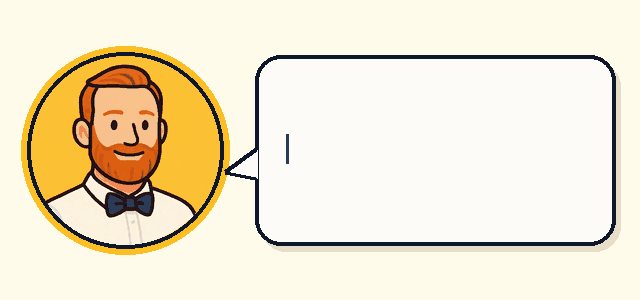
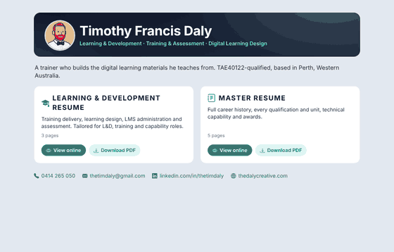
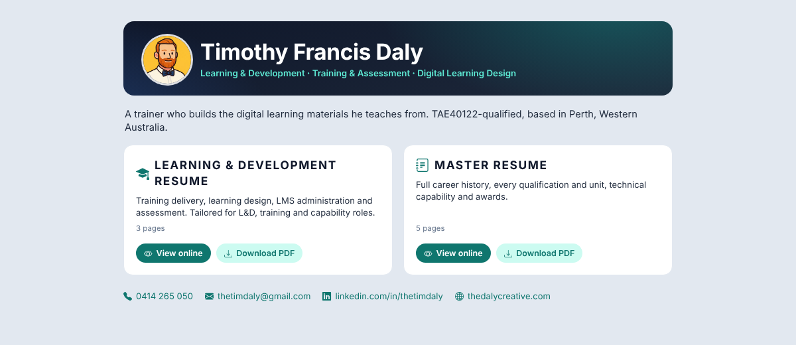
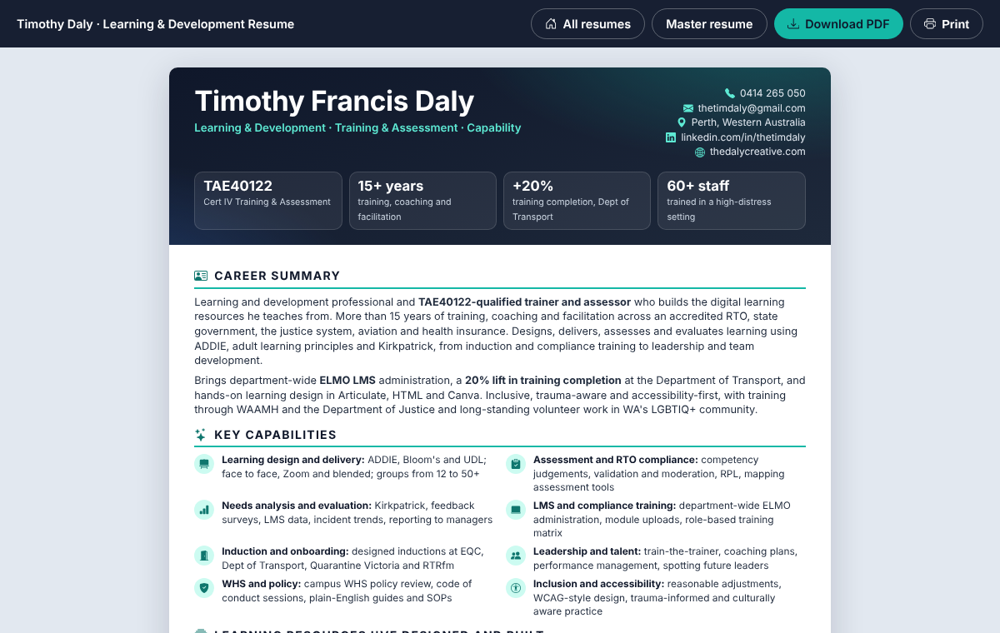
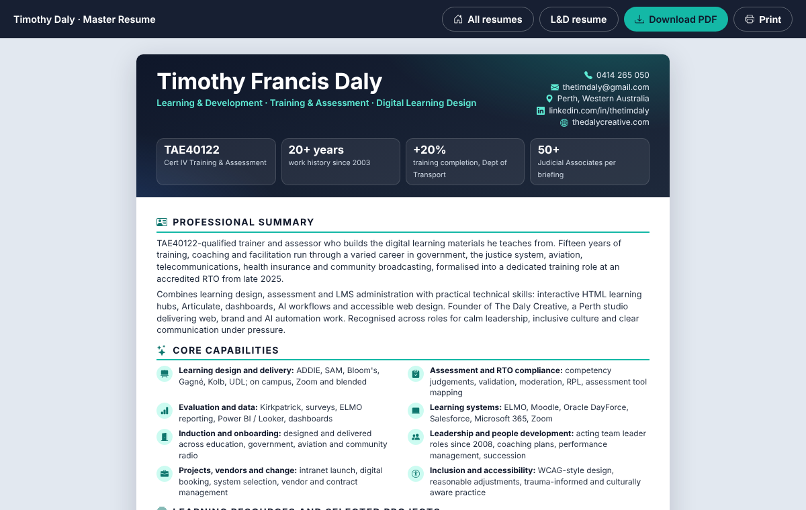
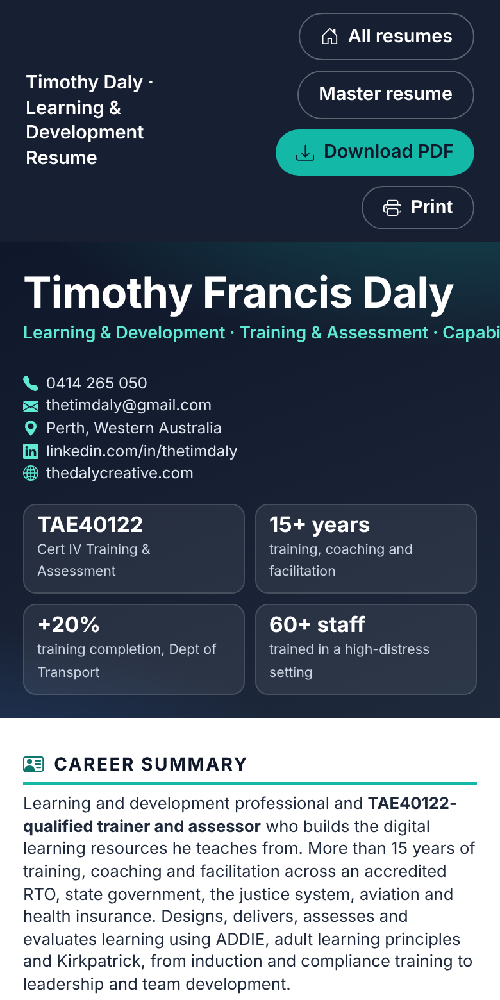
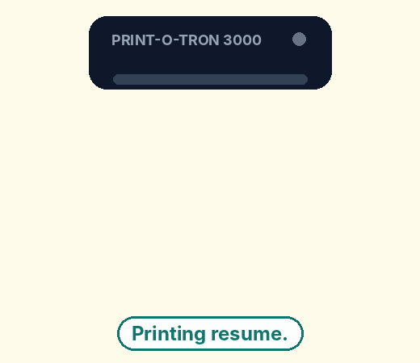

<div align="center">


<br>

[](https://thedalycreative.github.io/tim-daly-resumes/)
[](https://github.com/thedalycreative/tim-daly-resumes/deployments)
[](https://github.com/thedalycreative/tim-daly-resumes/commits/main)


<br>



</div>

---

## 👋 What's this?

The online home of my resumes. I'm a TAE40122-qualified trainer in Perth who builds the digital learning materials I teach from. This repo is the same idea applied to job hunting: a resume that is also a small, tidy website.

| Resume | Best for | View online | Download |
|---|---|---|---|
| 🎓 **Learning & Development** | L&D, training, capability and LMS roles | [ld-resume.html](https://thedalycreative.github.io/tim-daly-resumes/ld-resume.html) | [PDF · 3 pages](assets/pdf/Tim-Daly-Resume-Learning-and-Development.pdf) |
| 📚 **Master** | The full story: every role, unit and award | [master-resume.html](https://thedalycreative.github.io/tim-daly-resumes/master-resume.html) | [PDF · 5 pages](assets/pdf/Tim-Daly-Master-Resume.pdf) |

Or start at the landing page: **[thedalycreative.github.io/tim-daly-resumes](https://thedalycreative.github.io/tim-daly-resumes/)**

---

## 📸 Screenshots

<div align="center">

<br><sub>The tour: landing page, then a scroll through the L&D resume.</sub>
</div>

<br>

| Landing page | L&D resume |
|---|---|
|  |  |
| **Master resume** | **On a phone** |
|  |  |

---

## ✨ Features

- **Two resumes, one look.** A focused 3-page L&D version and a 5-page master with the full history.
- **Print-ready.** Each page has *Download PDF* and *Print* buttons, plus A4 print styles that keep sections from splitting awkwardly across pages.
- **Real logos, real links.** Employer logos and live links to the learning hubs and tools I've built.
- **Light and fast.** Plain HTML, CSS and a little JavaScript. No frameworks, no trackers, no cookie banner.
- **Accessible.** Semantic headings, alt text, good contrast and keyboard-friendly buttons.

---

## 🗂️ Structure

```
tim-daly-resumes/
├── index.html                 Landing page linking both resumes
├── ld-resume.html             Learning & Development resume
├── master-resume.html         Master resume
├── assets/
│   ├── css/
│   │   └── styles.css         Shared styles, including A4 print rules
│   ├── js/
│   │   └── scripts.js         Print buttons; external links open in a new tab
│   ├── images/
│   │   ├── avatar.jpg         Illustrated portrait (landing page)
│   │   ├── logo.png           Personal logo (favicon)
│   │   ├── logos/             Employer and organisation logos
│   │   ├── screenshots/       Images used in this README
│   │   └── *.gif, header.svg  README animations
│   └── pdf/                   Downloadable PDF versions
└── README.md
```

---

## 🛠️ How it's built

1. **Content.** Every line comes from one master reference document that holds my verified dates, qualifications and examples. If it's not in there, it's not on the resume.
2. **Generate.** A script turns that content into the two HTML pages, with icons from [Bootstrap Icons](https://icons.getbootstrap.com/) inlined as SVG.
3. **Assemble.** Styles, scripts and logos are split into `assets/` so every page shares them.
4. **Print.** Headless Chrome (via [Playwright](https://playwright.dev/)) prints each page to an A4 PDF, so the PDFs always match the web pages.
5. **Deploy.** [GitHub Pages](https://pages.github.com/) serves the `main` branch. Push a change and it's live within a minute or two.

### Run it locally

No build step needed to view it:

```bash
git clone https://github.com/thedalycreative/tim-daly-resumes.git
cd tim-daly-resumes
python3 -m http.server 8000   # then open http://localhost:8000
```

Or just double-click `index.html`.

---

## 🖨️ Printing

<div align="center">

</div>

Use the **Download PDF** button on either resume, or **Print** and choose *Save as PDF*. The layout is tuned for A4 with backgrounds on. Your office printer's mood is outside the scope of this project.

---

## 📬 Contact

**Timothy (Tim) Daly** · Perth, Western Australia

📞 0414 265 050 · ✉️ [thetimdaly@gmail.com](mailto:thetimdaly@gmail.com) · 💼 [linkedin.com/in/thetimdaly](https://linkedin.com/in/thetimdaly) · 🌐 [thedalycreative.com](https://thedalycreative.com)

<div align="center">
<sub>Referees available on request. Cartoon Tim is not available for interviews, but real Tim is.</sub>
</div>
